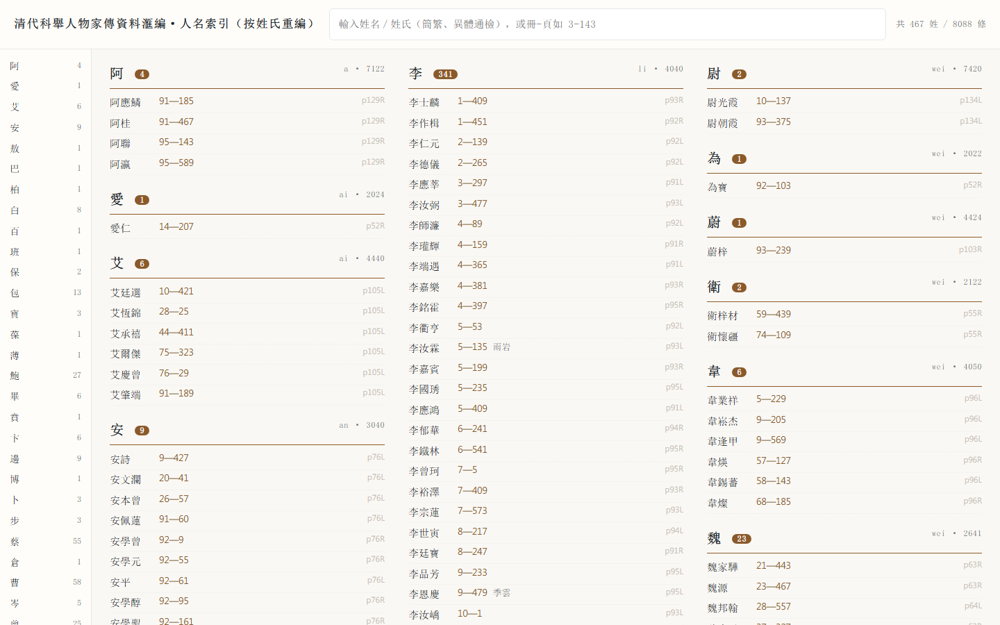
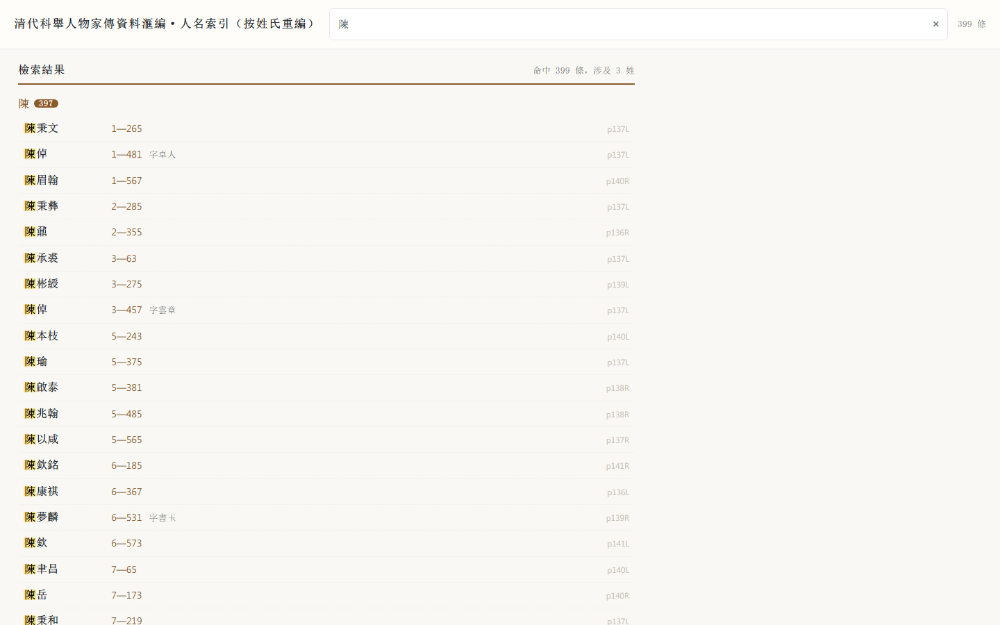

# 《清代科舉人物家傳資料滙編·人名索引》按姓氏重編

把 138 页、按**四角号码**排列的人名索引，全部 OCR 后**按姓氏重排**为一张可直接检索的表：**8088 条人名 / 467 个姓氏**，每条给出姓名、所在册次与页码（另注「字」、可回溯原书索引页）。成品是**一个单文件 HTML**，双击即开，无需联网、无需服务器。

**在线检索 → https://liuhao1106.github.io/qing-keju-renming-suoyin/**

| 主表（默认视图） | 检索结果（繁简、异体通检） |
| --- | --- |
|  |  |

---

## 一、为什么重编

原书索引按**四角号码**排：`0022₂ 廖` 之下挂一串人名，查一个人先要会算四角码，还要在 138 页里翻到对应码段。对绝大多数使用者来说，这本索引实际上**不可查**。

重编后，查人只有一件事可做：输入姓氏。附带解决的问题：

- **繁简、异体通检**：输「陈」出「陳」，输「日燈」出「日灯」，输「淩」也出「凌」；
- **只记得字号**：可按「字」检索（如「伯蘭」）；
- **只记得出处**：可倒查册-页（如 `3-143`）；
- **只记得读音**：可按姓氏拼音检索（如 `liao`）；
- 每条都保留**原书 PDF 页与左右栏**（`p20L`），随时可回原书对图。

## 二、规模

| 项目 | 数值 |
| --- | --- |
| 人名条目 | **8088 条** |
| 不同姓氏 | **467 个**（含复姓 6 个：歐陽 17、諸葛 5、申屠 2、皇甫 1、上官 1、司徒 1） |
| 覆盖册次 | 第 1–100 册 |
| 覆盖页码 | 第 1–627 页 |
| 索引页 | 138 页（PDF 第 19–156 页），每页左右两栏 |
| 带「字」注 | 125 条（原书索引**只注字、不注号**） |

条目最多的姓：王 477、張 415、陳 397、李 341、劉 247、吳 243、朱 231、徐 204、周 169、黃 159。

## 三、界面与检索

| 操作 | 效果 |
| --- | --- |
| 左侧姓氏栏 | 467 姓按拼音排序，点击跳转 |
| 输入姓名/姓氏 | 进入**独立结果面板**，按姓分组列命中者，命中字高亮 |
| 输入字号 | 同上，命中的「字」高亮（如「伯蘭」） |
| 输入 `3-143` | 倒查该册该页收录的所有人 |
| 输入 `liao` | 按姓氏拼音检索 |
| 点任一结果 | 跳回全表并闪烁定位该行 |
| 命中超 400 条 | 只列前 400 并提示细化关键词 |

繁简／异体通检由 `opencc` 逐字归一（`t2s` + 651 字手工异体表）实现，**只作用于检索，不改动任何数据**，故输出仍保持原书的繁体字形。

## 四、文件

| 文件 | 说明 |
| --- | --- |
| [`output/按姓重编.html`](output/按姓重编.html) | **成品**：单文件检索网页（1.0 MB，数据已内嵌） |
| [`output/按姓重编_全表.xlsx`](output/按姓重编_全表.xlsx) | 主数据：8088 行，冻结首行＋自动筛选，附「姓氏统计」表 |
| [`output/按姓重编_全表.csv`](output/按姓重编_全表.csv) | 同上，UTF-8-BOM，便于导入其他工具 |
| [`output/姓氏统计.csv`](output/姓氏统计.csv) | 姓氏＋拼音＋条目数 |
| [`交付文档.md`](交付文档.md) | 逐项修正记录、可信度证据、目验覆盖面、重跑步骤 |
| [`docs/`](docs) | 界面截图 |
| `*.py` | OCR → 解析 → 修正 → 出成果 → 生成网页 的全套脚本 |

### 字段

| 列 | 含义 | 示例 |
| --- | --- | --- |
| 姓氏 | 已还原到每条的姓（复姓已合并） | 廖 |
| 姓名 | 完整姓名（原书用「～」代姓） | 廖正亨 |
| 册 / 页 | 该人资料在《汇编》正书的册次与页码 | 3 / 143 |
| 四角号码 | 原书该姓的码，便于与原书对照 | 0022 |
| 字 | 原书括注的「字」（空＝无注） | 伯蘭 |
| 原书PDF页 | 可跳回索引原页 | 20 |
| 栏 | L / R | L |

## 五、方法与可信度

1. **切栏**：300dpi 渲染（约 2142×3030），按竖线列投影切左右栏，上下边界按行投影确定；16 个几何检测异常页单独补切。
2. **OCR**：PaddleOCR-VL 并发识别，断点续跑。
3. **解析**：OCR markdown → 记录。修掉两个影响全量的系统性 bug——① 表头常被输出成表格前的 `<div>`，只解析 `<tr>` 会丢掉整段表头；② 表头下标常被读成字母（`s/o/a`）或 Unicode 下标（`₀₄`），已归一化。
4. **校勘**：`qa.py` 的「块内四角码倒序」检查是最灵敏的漏表头信号（11 处漏头中 7 处由此揪出）；其余靠**逐页目验**。
5. **目验**：138/138 页表头盲转录比对 + 15/15 抽样栏逐行核对（约 460 条）+ 11 个强嫌疑罕见姓 4–5× 裁图放大裁决。

可信度要点：

- 表头四角码全局非递减，**0 违反**；册页范围全部落在 1–100 册、1–627 页，**0 越界**；
- 按「码＋附角」区分同码不同姓（金 `8010₉` vs 全 `8010₄`）；
- 解析器「噪声/未识别」行由 8 条逐条核实归零；块内倒序由 21 处降到 1 处（p71R，原书排版如此）。

**一条方法论教训**（详见 `交付文档.md` 第七节）：盲转录 agent 的**误报率高于 OCR 本身**——138 页比对出的 56 处「差异」里真错只有 6 处，其余 50 处是转录侧自己读错（榮→柴、瑀→璵、鳥→烏…）。所以必须是「转录 → 程序比对 → 原图放大裁决」三层，不能只信任何一方。

## 六、目录结构

```
科举人物家传索引/
├── output/                     成果（HTML / XLSX / CSV）
├── index.html                  GitHub Pages 入口（跳转到成品）
├── docs/                       界面截图
├── 交付文档.md                  修正总表、可信度证据、目验进度、重跑步骤
├── HANDOFF.md                  前期技术过程与踩坑记录（几何、切栏、失败原因）
├── slice_columns.py            PDF 每页切左右栏 → 分块 PDF + index.json
├── reframe.py                  16 个几何检测失败页补切
├── run_ocr.py                   PaddleOCR-VL 并发调用，断点续跑
├── parse_columns.py             OCR markdown → 记录（div/tr 合并、下标归一）
├── patch_p88.py / patch_html.py p88 跨栏页结构修补、网页局部补丁
├── apply_fixes.py              人工修正（漏头 / 单字 / 结构 / 整行补录）
├── audit_surnames.py           罕见姓程序化审计（同码组、检字表交叉）
├── qa.py                       质检（倒序、越界、噪声行）
├── render_verify.py            还原 276 张 300dpi 分栏图
├── prep_verify_tasks.py        切半图、固定种子抽样、生成目验任务
├── diff_hdr.py                 盲转录结果 vs 解析记录，按阅读顺序比对
├── build_output.py             生成 CSV / XLSX / HTML（含人工改字表）
└── html_build.py               HTML 生成器（繁简异体归一、结果面板、高亮、定位）
```

## 七、再生成

需要 Python 3.8+，依赖 `pymupdf pillow numpy openpyxl pypinyin opencc-python-reimplemented`，以及 OCR 服务的 token（`PADDLEOCR_TOKEN`）与 OCR 脚本路径（`PADDLEOCR_SCRIPT`，默认 `~/.claude/skills/paddleocr/paddleocr_ocr.py`）。

```bash
# 1) 切栏分块
python slice_columns.py --pdf "清代科举人物家传资料汇编  索引.pdf" --pages 19-156 --chunks --chunk 10
# 2) OCR（约 30 分钟，5 并发，可断点续跑）
python run_ocr.py --pdf "清代科举人物家传资料汇编  索引.pdf" --pages 19-156 --out work/cols_full --chunk 10 --jobs 5
# 3) 解析 + p88 修补
python parse_columns.py --dirs work/cols_full,work/cols_fix,work/cols_fix2 --out work/all/records_v3.jsonl
python patch_p88.py --records work/all/records_v3.jsonl
# 4) 人工修正 → 质检 → 出成果
python apply_fixes.py --in work/all/records_v3.jsonl --out work/all/records.jsonl
python qa.py --records work/all/records.jsonl
python build_output.py --records work/all/records.jsonl --outdir output
```

只改数据时只需后三步。`work/`（OCR 原始结果与 233 MB 目验图）不入库；原书 PDF 因版权原因也不入库。

## 八、已知限制

- **OCR 残余形近字**：个别两可字按 OCR 判定（如 p55R 養怛／養恒）；单字名（廖琦、靈垕、杜）原书即单名，非截断。
- **原书只有「字」没有「号」**，故无「号」列。
- **原书重复 1 条**（曹燧 61—491 印了两次），输出已去重。
- **书前笔画/拼音检字表** OCR 不完整，**未**用于自动改姓（实测会误改），仅作交叉提示。
- 索引给的是**资料所在册页**，不含人物生卒、籍贯等信息——本仓库只做索引搬运，不做人物考订。

## 九、数据来源与版权

- **原书**：《清代科舉人物家傳資料滙編》所附人名索引；索引按四角号码编排，本工程只重排**索引**，不复制正文。
- **成果性质**：条目姓名、册页、四角码、字注均转录自原书索引，属事实性数据；**重排、校勘、检索界面与代码**为本项目整理者成果。
- 原书著作权归编者与出版方。本仓库仅供学术研究使用，不作商业用途；如需引用，请以原书为准并核对原页（每条都给出 `p##L/R` 定位）。
- 原书扫描件不在本仓库。

## 十、引用

```
《清代科舉人物家傳資料滙編·人名索引》按姓氏重編，
8088 条 / 467 姓，https://github.com/liuhao1106/qing-keju-renming-suoyin
```

---

## English

A surname-indexed edition of the name index to *Qing Dynasty Examination Candidates' Family Biographies* (清代科舉人物家傳資料滙編). The original index is ordered by **four-corner code**, which makes it practically unusable for looking up a person. This project OCRs all 138 index pages (PaddleOCR-VL), re-orders the **8,088 entries under 467 surnames**, and ships a single-file offline HTML with:

- four query modes — name/surname, courtesy name (字), volume–page reverse lookup (`3-143`), surname pinyin (`liao`);
- traditional/simplified and variant-character equivalence (651-char manual variant table plus OpenCC t2s, query-side only);
- per-entry traceability back to the original index page and column (`p20L`).

Every one of the 138 pages was independently blind-transcribed and diffed against the parsed records; 15 sample columns were checked line by line. Data: CSV/XLSX with surname, full name, volume, page, four-corner code, courtesy name, source page, column. Only the index is reproduced — no body text, no scanned pages.
